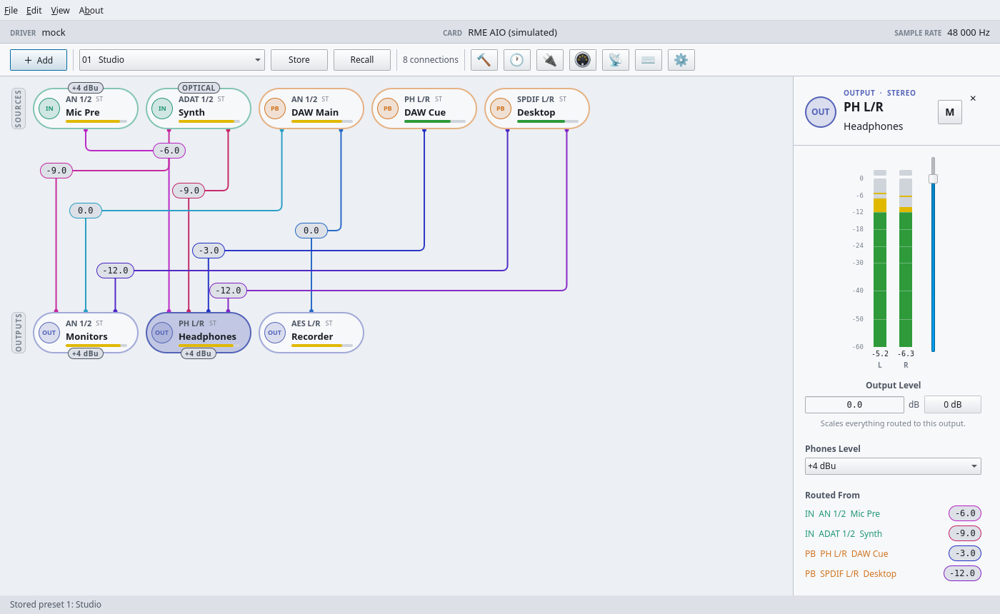
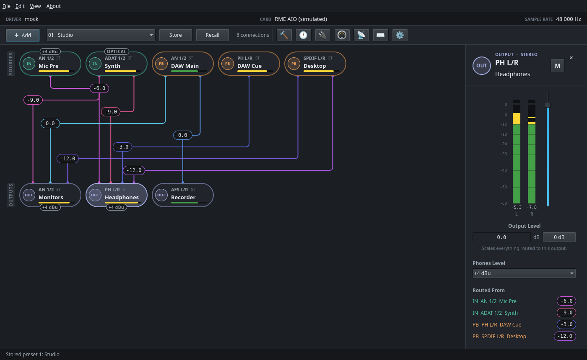

# AA-HDSPe-AIO-Mixer
Linux desktop application for controlling hardware mixer functions of RME HDSPe AIO (Pro) audio cards

Routing-focused hardware-mixer control for **RME HDSPe AIO** and **AIO Pro** audio cards on Linux (target: Debian 13, KDE Plasma).
It works with the in-kernel **snd-hdspm** driver (AIO, and the AIO Pro since Linux 7.3; single speed) and the out-of-tree **snd-hdspe** driver (AIO and AIO Pro, all speeds).





## Install

Grab the latest installer from [Releases](https://github.com/AtmanActive/AA-HDSPe-AIO-Mixer/releases):

- Debian 13, Ubuntu 24.04 and later: `sudo apt install ./aa-hdspe-aio-mixer_<version>-1_all.deb`
- Fedora: `sudo dnf install ./aa-hdspe-aio-mixer-<version>-1.<fedora>.noarch.rpm`
- CachyOS, Arch Linux: `sudo pacman -U aa-hdspe-aio-mixer-<version>-1-any.pkg.tar.zst`
- Any other x86_64 distribution: the AppImage (`chmod +x`, then run it). It brings its own Python and Qt,
  and has everything except keyboard shortcuts.

## Features

- Routing view: card sources on top, outputs below, one wire per connection, with configurable level in dB and mute state.
- Mono or stereo channels, your own channel names, and peak meters on every channel.
- Per-connection and per-output levels, and mutes on every channel and connection.
- 64 named presets with selective recall; preset files; export everything to one file and import the parts you pick.
- Card settings: analog input and output levels, phones level, S/PDIF and ADAT inputs, TMS, and more.
- Clock: sample rate, clock source with each input's sync status, and sample-rate tuning.
- Test tones on any playback channel.
- Virtual PipeWire input and output devices on chosen channels of the card.
- Remote control by MIDI (with lights and motor-fader feedback), OSC (with feedback) and KDE Plasma global
  keyboard shortcuts.
- System tray, light and dark themes, and zoom from 25 % to 400 %.
- Works with the in-kernel snd-hdspm driver and the out-of-tree snd-hdspe driver; single, double and quad
  speed with snd-hdspe.

## Using it

**On start, the app writes its stored routing to the card.** The hardware mixer is write-only, and its
state after the driver loads differs by driver and distro, so the app's memory is the reference.
The first time it runs, the memory is empty and the card goes silent until you add connections. Don't run
hdspmixer at the same time: both would write the mixer, and both would read the meters, which reset
their peaks on every read.

- **Info bar** (always visible): the driver (left), the card (centre) and the sample rate (right). Hover over one for the details: the driver version; the card revision, firmware build and serial number; the speed mode (single, double or quad).
- **Toolbar:** **Add** opens the connection picker. The preset drop-down (64 named slots) works with
  **Store** and **Recall**. A preset stores everything: routing, connection and output levels, mutes, mono/stereo,
  and channel names. **Recall** (and loading a preset file, and recalling from the tray) first opens a confirmation
  with five checkboxes, all checked every time:
  - **Names:** channel names;
  - **Destinations:** which sources feed which outputs, plus mono/stereo. Without Levels, already-routed
    connections keep their level and new ones get 0 dB;
  - **Levels:** connection and output levels. Without Destinations, only existing connections change;
  - **Mutes:** muted channels and connections. Without Destinations, only existing connections change;
  - **Card IO settings:** the card's own switches, such as the analog levels and S/PDIF (the tooltip lists
    them). Presets saved before card settings existed leave them alone.
- **Routing view:** routed sources (inputs, playback) are on top and routed outputs at the bottom, with a
  wire for each connection. Connections at -inf don't exist and aren't drawn. The number on each wire is
  its level in dB:
  - click it to type a value (`-inf` removes the connection; an empty box means 0 dB). Enter or a click
    anywhere outside the box applies it; Esc cancels;
  - scroll on it for ±0.5 dB, down to -90.3 dB (the quietest level). Scrolling never removes the connection;
  - middle-click it to mute or unmute the connection;
  - right-click it for quick values, **Mute Connection** or **Remove Connection**.
- **Channel pills** show the hardware name and your own name, a peak meter, and ST/M (stereo or mono).
  Double-click a pill to rename it. Right-click it to rename, switch stereo/mono, remove all routes to
  an output, or **Test** a playback channel. Switching between mono and stereo never loses routing: the view
  is derived from the full matrix.
- **Channel test (playback channels):** **Test** (pill menu, or under the meter in the channel info) plays
  three sine bursts at -6 dBFS, 880, 440 and 220 Hz, half a second each with half a second between them. On
  a stereo pair it plays on the left channel, then half a second later on the right. Click **Stop Test** to
  stop it early. It plays into the card's playback channel, so it is heard wherever the mixer routes that
  channel (nothing if it isn't routed). Turn monitors and headphones down first: -6 dBFS is loud.
  - With PipeWire (the usual desktop): it plays to the card's PipeWire sink only, never to another device,
    and that sink's volume applies. The sink must have the channel (the card's Pro Audio profile has all).
  - Without PipeWire: straight to the ALSA device (`aplay -D hw:N`), which fails while another program holds
    the card.
  - ALSA's playback channels come in the order Analog, AES, S/PDIF, ADAT, Phones, AEB, unlike the mixer's
    (`core/tone.py` maps them).
- **Channel info (click a pill in the routing view):** the side panel switches to that channel (like the
  🔨/🕐/🔌/MIDI/📡/⌨️/⚙️ buttons; click the pill again or ✕ to close). It follows the channel through a stereo/mono
  change, and closes if a sample-rate change removes the channel (ADAT at double and quad speed).
  - Header (stays put): kind (input, playback, output), stereo or mono, hardware name, your name.
    Double-click **STEREO**/**MONO** for a drop-down to switch it (from either channel of a pair: 1+2,
    3+4, …); Esc or a click outside closes it unchanged. Double-click the name to edit it: Enter or a click
    anywhere outside the box applies it, Esc cancels. The square **M** button mutes or unmutes the channel
    (lit while muted).
  - Below it, one column that scrolls when the window is short, top to bottom:
    - a tall peak meter per channel (dBFS, -60 to 0), with the peak held 1.5 s as a line and a number, and a
      clip light that stays lit (at -0.1 dBFS or more); click the meter to reset both. For a playback
      channel, **Test** under it (see Channel test). For an output, also its **Output Level**: a fader
      beside the meter (-60 to +6 dB; double-click it for 0 dB), a box to type a value (`-inf` too; Enter or
      a click outside applies it, Esc cancels) and **0 dB**;
    - the channel's card settings as drop-downs (as on the pill's right-click menu);
    - **Routed From/To**: every connection to or from the channel with its level, which works like the
      number on a wire; click a channel's name to show that one. For an output, **Remove All Routes to This
      Output** at the bottom.

  The panel keeps its usual width for this section.
  Per-channel meter values are sent only while the section is shown.
- **PipeWire virtual devices (🔌 next to 🕐):** stereo PipeWire devices on chosen channels of the card, for
  desktop apps. On the Pro Audio profile (which the AIO Pro needs for playback) the card is one 16/18-channel
  device that ordinary apps can't use; pick one of these in the desktop's sound settings instead.
  - **Add Input** / **Add Output** in the section's header open a new box at the top: a name (what apps show),
    and the card channel for left and right, named as in the app with PipeWire's channel in brackets, e.g.
    "AES L (AUX2)". **Apply** makes the device; **Cancel** drops the box. A device made has only **Remove**.
    Make as many as you like. Names must differ among inputs and among outputs (an input and an output may
    share one). The devices are listed inputs first, then outputs, each by name, with their state, read every
    2 s while the section is shown: running, starting, not running, or the card's channels missing (e.g. the
    card is on another profile than when the device was made).
  - How: each device is a small PipeWire process of its own, loading `module-loopback` with
    `stream.dont-remix` so it uses exactly the chosen channels, linked to them with `pw-link` (WirePlumber
    doesn't route onto Pro Audio devices by itself). The same method as
    [PipeWireController](https://github.com/knightinfected/PipeWireController), written anew for this app. A
    systemd user unit runs it, enabled with `pipewire.service`, so the device stays after the app quits,
    comes back at login and restarts with PipeWire. Making or removing one never restarts PipeWire. The app
    puts back any of its links that went missing, at start and while the section is shown.
  - Files: `~/.config/aa-hdspe-aio-mixer/virtual/<id>.json`, `.conf` and `.link.sh`, and
    `~/.config/systemd/user/aa-hdspe-virtual-<id>.service`. Remove devices from the app, which deletes them all.
  - With `--mock`, devices are only kept in memory: nothing is written and PipeWire isn't touched.
- **MIDI remote control (the MIDI socket button, next to 🔌):** channel and connection mutes, output and connection levels, and
  preset recalls from a MIDI controller, with its lights and motor faders kept in step. App-wide and never in
  presets: `~/.config/aa-hdspe-aio-mixer/midi.json`. It works with the window in the tray too.
  - The section's header has the **On/Off** switch for all of it, the **In** port (the controller) and the
    **Out** port (feedback to it), and **Add**. A chosen port that isn't plugged in stays chosen and is
    connected when it shows up. The app's own ports ("AA-HDSPe-AIO-Mixer", "Control In" / "Feedback Out") can
    also be connected with other tools (qpwgraph, aconnect). Off closes the app's MIDI client altogether.
  - **Add** opens a new box at the top. **Control**: Mute, Level or Preset recall. **Target**: a channel or a
    connection (mutes); an output or a connection (levels); a preset, or "By number" (the program number, or
    the CC value, picks it: 0 = preset 1). **MIDI**: note, controller (CC) or pitch bend for mutes; CC or
    pitch bend for levels; program change, note, CC or pitch bend for presets (pitch bend only for one preset,
    not "By number"); **Channel** (1–16 or Any) and the note, CC or program number (pitch bend has none: one
    per channel). **Learn** fills those in from the next message received. Behaviour: mutes **Toggle on each
    press**, **Mute on each press**, **Unmute on each press** (one button each for mute and unmute), or
    **Mute while held** (a held note, a CC value of 64 and up, or a pitch bend bent at least
    halfway up); a pitch bend toggles or recalls once each time it gets bent up, not on every message on the
    way. A level on pitch bend uses its whole 14-bit travel. Levels have a **Top** and **Bottom** level
    (−∞ to +6 dB; with −∞ at the bottom the level follows a desk fader's curve, otherwise it moves evenly in
    dB). **Inverted** swaps high and low. **Apply** saves it; a saved binding has **Edit** and **Remove**.
    Bindings are listed mutes first, then levels, then presets, in the Target list's order; one message may
    drive several. Message texts start with the MIDI channel: "CH01: CC 7", "CH--: Note 060 (C4)" (any
    channel); the panel's **Last received** box shows incoming messages the same way.
  - Channel targets follow their channel into or out of a stereo pair. A connection target only acts while
    that connection exists, and MIDI never removes a connection (its lowest level is −90 dB). A preset recall
    restores everything in the preset.
  - Feedback, on the Out port, whenever a mute or level changes (from MIDI, the window or a preset): mutes as
    note-on velocity 127/0 or CC 127/0, levels as their CC value or pitch bend. A level moved from the
    controller isn't sent back to it, so motor faders don't fight. Presets, and mutes on pitch bend, send no
    feedback.
  - How: ALSA sequencer through ctypes (`core/alsaseq.py`), no extra packages; bindings in `core/midi.py`.
- **OSC remote control (📡 next to the MIDI button):** the same as MIDI, over the network with OSC (TouchOSC,
  Open Stage Control, a DAW, a script). App-wide and never in presets: `~/.config/aa-hdspe-aio-mixer/osc.json`.
  It works with the window in the tray too.
  - The section's header has the **On/Off** switch, **In** (the UDP port controllers send to, 8000 by
    default), **From** (**This computer only**, the default, or **The network**: then the panel says this
    computer's address to send to; OSC has no passwords, so anyone who can reach the port can control the
    mixer), **Out** (the controller's host name or address for feedback, none by default, and its UDP port,
    9000 by default: TouchOSC's own defaults), and **Add**.
  - A binding has **Control**, **Target** (as MIDI's; "By number" picks the preset by the value, 1 = preset 1),
    the OSC **Address** (exactly, e.g. `/1/fader1`; no wildcards) with **Learn**, and the same behaviour as
    MIDI: mute **Action** and **Inverted**, level **Top** and **Bottom**. A level's **Value** is a
    **Position, 0 to 1** (as faders send it, mapped with the limits and the fader curve) or a **Level in dB**
    (kept within the limits; −100 and below is −∞). Learn takes the next message's address, and picks
    "Level in dB" for a level whose value isn't within 0 to 1.
  - The value is the message's first number (int, float, true/false). A press is 0.5 and up, or a message
    with no value; bundles are taken apart (their time tags are ignored). **Last received** shows the address
    and the values.
  - Feedback, to the Out host and port, as one float: mutes 1.0 / 0.0, levels as their position or in dB.
    As with MIDI, a level moved from the controller isn't sent back to it, and presets send no feedback.
  - How: Qt's UDP socket (`QtNetwork`), no extra packages; `core/osc.py`. MIDI and OSC share the binding
    engine in `core/remote.py`.
    With `--mock`, there is one simulated controller and no ALSA client.
- **Keyboard shortcuts (⌨️ next to 📡):** the same as MIDI, from keys pressed anywhere on the desktop,
  whichever window has the focus: KDE Plasma's global shortcuts. App-wide and never in presets:
  `~/.config/aa-hdspe-aio-mixer/shortcuts.json`. It works with the window in the tray too. There is no
  feedback.
  - The section's header has the **On/Off** switch and **Add**. Off, and while the app isn't running, the
    keys are free for anything else (as with KDE's own apps).
  - A binding has **Control**, **Target** (as MIDI's; a preset recall is always one preset: a key has no value
    to pick one by) and **Keys** with **Learn**, which takes the next keys pressed in the window (Esc
    cancels; Plasma's own shortcuts don't act meanwhile). An ordinary key needs Ctrl, Alt or Meta with it;
    F1–F35 and media keys may be used alone. **Clear** leaves a binding without keys, to give it some later.
  - Mutes: the same four **Actions** as MIDI; **Mute while held** unmutes when the keys are let go, and
    can be **Inverted** (sounding while held). Levels: **Up a step** or **Down a step** on each press (a
    **Step** of 1–24 dB, kept between **Top** and **Bottom**; with −∞ at the bottom the steps go between
    −60 dB and the top, and one more step down is −∞), or **Set a level**.
  - Each binding is a shortcut of the app in System Settings › Keyboard › Shortcuts (named like
    "Mute or unmute: Input AN 1/2"), where its keys can be changed too: the panel follows. Removing its keys
    there deletes the binding (also when the app wasn't running). A key combination
    Plasma already has for something else can't be used; the panel says what has it. **Last received** shows
    the keys pressed and let go. A held key repeats: once Plasma has said a key was let go, a repeat isn't
    another press (levels keep stepping).
  - How: Plasma's global shortcuts service (kglobalaccel, in KWin) over D-Bus with Gio (`python3-gi`, which
    KDE's Debian desktop has already); `core/shortcuts.py`. Without Plasma, the panel says so. With `--mock`,
    nothing is given to Plasma.
- **App settings (⚙️ next to ⌨️):** shows the app's own settings in the side panel. App-wide, not per card: `~/.config/aa-hdspe-aio-mixer/settings.json`.
  - **Start Window:** how should the window appear when the app starts. **Minimized**: straight into the system tray,
    window not shown. **Maximized**: shown maximised. **Window** (default): a normal window at its remembered
    size. **Last**: the way it was left at the last quit (in the tray, maximised, or a normal window).
    `--hidden` on the command line still starts in the tray, whatever this says.
  - **Color Mode:** **System** (default) follows the desktop's light/dark colour scheme, and switches live
    when the desktop does. **Light** and **Dark** fix the app's colours whatever the desktop uses.
  - **Zoom:** the size of the whole app (text, controls, pills, dialogs, menus), 25, 30, 40, 50, 60, 75, 80,
    100 (default), 125, 150, 175, 200, 250, 300 or 400 %. It uses Qt's scale factor
    (`QT_SCALE_FACTOR`, multiplied by any you set yourself), which Qt reads only at start, so a change asks for
    a restart: **Restart Now** saves everything, quits and starts the app again with its window shown. The
    window keeps its size on screen across zoom changes.
  - **For this card:** two display settings that are kept in the card's memory, not in `settings.json`, and are
    also in the View menu. **Wire Colours**: the hue step between connections' wires, 0–180° (default 20°;
    type a value, use the arrows, or **Default**). **Meter Refresh Rate**: 10, 20 (default) or 30 Hz.
- **Clock (🕐 next to 🔨):** shows the clock section in the side panel. Nothing in it is stored in presets or memory: the card owns its clock.
  - **Sample Rate:** drop-down for the internal clock's rate. A program that plays or records sets its own
    rate. Under snd-hdspm only single-speed rates (32, 44.1, 48 kHz) are offered, because that driver
    loses the AIO at double and quad speed.
  - **Clock Source:** Internal (the card is the clock master), or ADAT, AES, S/PDIF, TCO or Sync In (the
    card follows that input, AutoSync). Each row shows that input's clock: Sync, Lock, No signal or Not
    available, with its rate; ● marks the one in use. Sources the card or driver doesn't offer are
    disabled (TCO needs a TCO module).
  - **Sample Rate Tuning:** slider and editable readout in Hz, ±5 % around the internal rate, with Reset.
    Only with the Internal source. snd-hdspm: `System Sample Rate`; snd-hdspe: its `DDS` register.

  The clock is re-read every second only while the section is open and the window is shown (`core/clock.py`).
- **Side panel and card settings (🔨 next to Recall):** the panel on the right is always shown and
  holds one section at a time. 🔨, 🕐, 🔌, MIDI, 📡, ⌨️ and ⚙️ work like radio buttons: each switches the panel to its section
  (closing the one shown), and clicking the lit button again empties the panel. Clicking a pill shows the
  channel info section the same way. Every section has a header that stays put while the rest scrolls, with
  ✕ on the right to close it. 🔨 shows the card-settings
  section (the card's other settings, as drop-downs). The button and panel are the same for every card; what's inside depends on the
  card. Clock and sample-rate settings won't go here. Nothing in this panel is stored in or recalled from
  presets; it's kept in the card's memory and written to the card at start. So far:
  - **Analog Breakout Cable** (AIO): RCA or XLR. The AIO Pro has no such switch (its output levels name
    RCA/XLR themselves).
  - **TMS (Track Marker Support)** (AIO, AIO Pro): Off or On. Passes the channel status and track marker
    data of the S/PDIF and AES inputs on to the computer. snd-hdspe only (its `Clear TMS` control, which
    is inverted); under snd-hdspm the panel shows it disabled, as "Not available with snd-hdspm".
  - **Single Speed Word Clock Out** (AIO, AIO Pro): Off or On. Keeps the word clock output at single speed
    (44.1/48 kHz) when the card runs at double or quad speed. Both drivers.
- **Card settings:** switches on the card itself, indexed per card model (`core/card_settings.py`), so other
  cards can be added later. The AIO (and AIO Pro) has these so far:
  - **Analog Input Level** (hardware input trim of analog in 1/2): right-click the analog input pill.
    AIO: Lo Gain, +4 dBu or -10 dBV (snd-hdspm calls Lo Gain "Hi Gain"; the app shows and stores Lo Gain
    under both drivers). AIO Pro: +4, +13, +19 or +24 dBu. Always shown as a tag on the pill's top edge.
  - **Analog Output Level** (analog out 1/2) and **Phones Level** (phones): right-click the analog output or
    phones pill. AIO: Hi Gain, +4 dBu or -10 dBV. AIO Pro: -2/+4/+13/+19 dBu RCA or +4/+13/+19/+24 dBu XLR,
    and phones Lo Power or Hi Power. Always shown as a tag on the pill's bottom edge. This is the card's
    analog reference level; **Output Level…** in the same menu is the app's own per-output level.
  - **S/PDIF Input** (Optical, Coaxial or Internal): right-click the S/PDIF input pill. The current choice is
    always shown as a tag on the pill's top edge.
  - **S/PDIF Output**: right-click the S/PDIF output pill. Two sections: **Connectors** (Coaxial only, or
    Coaxial + Optical) and **Format** (Consumer or Professional). The coaxial output always runs; Coaxial +
    Optical also copies S/PDIF to the optical port, which then no longer carries ADAT. Always shown as one
    tag on the pill's bottom edge: `COAX` or `COAX+OPT`, then `C` (consumer) or `P` (professional), e.g.
    `COAX · C`.
  - **ADAT Input** (ADAT input pills), two sections:
    - **Connector:** Optical, or Internal (the ADAT In header for an AEB4-I, AEB8-I or TEB expansion
      board). This is a card switch, stored in presets.
    - **Optical Port:** ADAT or S/PDIF. The AIO has one optical input, shared by ADAT and S/PDIF;
      choosing S/PDIF sets S/PDIF Input to Optical. Going back to ADAT restores the S/PDIF input's previous
      connector (Coaxial or Internal).

    Tag: `OPTICAL`, `INTERNAL`, or `OFF` when ADAT is on the optical connector while S/PDIF uses it.
    [inferred] With ADAT on the internal header, the optical connector is free for S/PDIF, so ADAT stays on.
  - **Optical Output** (ADAT output pills): ADAT or S/PDIF. While S/PDIF Output is Coaxial + Optical, the
    optical port carries the S/PDIF copy, ADAT output is off and the ADAT output pills show `OFF`
    (otherwise `ADAT`).

    The Optical Port / Optical Output choices aren't switches of their own; they're stored in presets and
    memory through the S/PDIF settings.

  The app saves the choices and writes them to the card at start, like the routing. It also re-reads the
  card every second while the window is shown (not while it's hidden or minimised; it re-reads at once
  when shown again), so a change made elsewhere (alsamixer) shows up in the app. On source pills, the
  card-setting tag sits on the top edge and MUTED on the bottom edge. On output pills it's the other way
  round: MUTED and the output level on the top edge, the card-setting tag on the bottom edge.
- **Mute:** every input, playback channel, output and connection can be muted: middle-click it, or right-click
  it and choose **Mute**. Everything starts unmuted. The card gets -inf for whatever a mute covers, but a mute
  is not a level: the connection stays, keeps its level and comes back exactly on unmute. Removing a
  connection is a different, explicit action (and drops its mute). A muted pill has a red **MUTED** tag (bottom edge on sources, top edge on outputs); a
  muted connection's level is red and struck through; a wire is dashed when its connection, source or output
  is muted. Mutes survive mono/stereo switches and are saved in memory and presets.
- **Wire colours:** each new connection's wire is the previous hue plus a step, to make overlapping wires distinguishable. Colours follow creation order and don't change when other connections are added or removed. Change the step under View > Wire Colours… or in the app settings (⚙️) (default 20°; 0 colours wires by source type).
- **Output level:** right-click an output, then choose **Output Level…** (default 0 dB, -inf … +6 dB). Like TotalMix/hdspmixer, it scales every route into that output; the stored route levels stay unchanged. A yellow tag on the output shows the level only when it isn't 0 dB. Presets and memory files include output levels.
- **Add:** choose Inputs *or* Playback, pick one source, one or more outputs, and a level.
- **File:** load or save a preset file. **Export Memory** saves everything to one file: routing (channel names,
  mono/stereo, connections, levels, mutes), presets, card settings, clock settings, PipeWire virtual devices,
  and MIDI, OSC and keyboard shortcut control. **Import Memory** asks which of the file's parts to bring in
  (**All** and **None** tick or untick them; hover over one to see what the file has). Each part ticked
  replaces the app's; the others stay as they are. Under **Presets**, **Import** brings all of the file's
  presets (**IMPORT ALL PRESETS**), or only one of them, into the slot picked in **Into slot** (it starts at the
  preset's own slot; the other slots stay). Files exported before this have routing, presets and card
  settings only.
- **Close or minimise** hides the window to the tray (on Wayland too, where the app notices a minimise by the
  window being suspended). Meters stop while hidden. The engine keeps running
  (MIDI, OSC and keyboard shortcut control keep working). Click the tray icon to show or hide the window. Right-click it for **Show**, Recall Preset, Show Meters and **Exit**.

On start, the app also installs (or refreshes) `~/.local/share/applications/aa-hdspe-aio-mixer.desktop` and its icon under `~/.local/share/icons/hicolor/`. KWin on Wayland takes the window icon from that file, not from the app, and it also adds a menu launcher. The entry names its icon by full path, so no icon-theme lookup is involved. Use `--no-desktop-entry` to skip this (`--mock` skips it too). If the launcher doesn't list the app after the first start, run `kbuildsycoca6`.

Memory is saved automatically to `~/.config/aa-hdspe-aio-mixer/memory-<model>_<serial>.json`.

The window's size, position and maximised state are remembered app-wide in `~/.config/aa-hdspe-aio-mixer/window.json`
(saved when the window is hidden to the tray and when the app quits). On Wayland the compositor decides where windows
go, so only the size and maximised state come back there; the position is restored on X11. On KDE Plasma (Wayland),
a KWin window rule can remember the position instead: System Settings > Window Management > Window Rules, a rule for
window class `aa-hdspe-aio-mixer` (exact match, normal windows) with Position set to "Remember".

## Layout of the code

- `aa_hdspe_mixer/core/`: no GUI imports.
  - `alsa.py`: ctypes libasound control API.
  - `meters.py`: hwdep peak/RMS ioctl.
  - `card.py`: detection and info.
  - `card_settings.py`: card-specific settings per model (controls, choices, which channel they belong to).
  - `clock.py`: sample rate, clock source, input clock status and tuning, for both drivers.
  - `app_settings.py`: the app's own, app-wide settings (start window, colour mode, zoom).
  - `pwvirtual.py`: virtual PipeWire devices on the card's channels.
  - `alsaseq.py`: ctypes libasound sequencer API (MIDI ports and messages).
  - `midi.py`: MIDI remote control: bindings, mapping, feedback.
  - `osc.py`: OSC remote control: the OSC format, UDP, bindings, mapping, feedback.
  - `shortcuts.py`: keyboard shortcuts: KDE Plasma's global shortcuts over D-Bus, bindings, level steps.
  - `remote.py`: what MIDI, OSC and keyboard shortcuts share: applying bindings to the mixer, feedback, the
    level curve.
  - `channels.py`: channel map per speed.
  - `routing.py`: matrix and the mono/stereo routing view.
  - `memory.py`: names, presets, files.
  - `engine.py`: timers, hardware writes with retry on EBUSY.
  - `backend.py`: real and simulated card.
- `aa_hdspe_mixer/ui/`: Qt application shell (tray, single instance, file dialogs), the QML bridge, and
  the QML views.
- `packaging/`: build scripts for the Debian, Fedora and Arch packages and the AppImage (see Releases).
- `.github/workflows/release.yml`: builds them all and makes a draft release, on demand.

## Development

### Requirements (Debian 13)

```
sudo apt install python3-pyside6.qtcore python3-pyside6.qtgui python3-pyside6.qtwidgets \
  python3-pyside6.qtqml python3-pyside6.qtquick python3-pyside6.qtquickcontrols2 python3-pyside6.qtsvg \
  qml6-module-qtquick qml6-module-qtquick-controls qml6-module-qtquick-layouts \
  qml6-module-qtquick-window qml6-module-qtquick-templates python3-gi
```
`python3-gi` is only for the keyboard shortcuts (KDE Plasma's global shortcuts); without it the rest works.
Tests also need `python3-pytest`, and the UI tests (`tests/test_ui.py`: the real window on a mock card,
driven with simulated clicks and keys, offscreen) need `python3-pyside6.qttest`; without it they are skipped.

### Running

```
python3 -m aa_hdspe_mixer              # first AIO / AIO Pro found
python3 -m aa_hdspe_mixer --hidden     # start in the system tray
python3 -m aa_hdspe_mixer --mock       # simulated card, no hardware needed
python3 -m pytest -q tests
```

### Releases

The version is set in one place, `aa_hdspe_mixer/__init__.py`. To release, raise it there, push, then run
the **Release** workflow by hand (GitHub: Actions → Release → Run workflow). It runs the tests, builds the four
packages and puts them in a draft release tagged `v<version>`; publish the draft on GitHub when it looks
right. Running it again for the same version replaces the draft; once that version is published, the
workflow stops until the version is raised.

The build scripts are in `packaging/` and run the same way on a computer of that distribution; the
packages land in `dist/`:

| Package | Script | Needs |
|---|---|---|
| Debian (`.deb`) | `packaging/debian/build.sh` | `dpkg-deb` |
| Fedora (`.rpm`) | `packaging/fedora/build.sh` | `rpm-build` |
| CachyOS / Arch (`.pkg.tar.zst`) | `packaging/arch/build.sh` | `base-devel` (as a normal user) |
| AppImage | `packaging/appimage/build.sh` | `curl`; downloads Python, PySide6 and appimagetool |

The packages install the app in `/usr/share/aa-hdspe-aio-mixer`, outside Python's site-packages, so they
don't depend on one Python version, with the launcher `/usr/bin/aa-hdspe-aio-mixer`.

## License

MIT License
